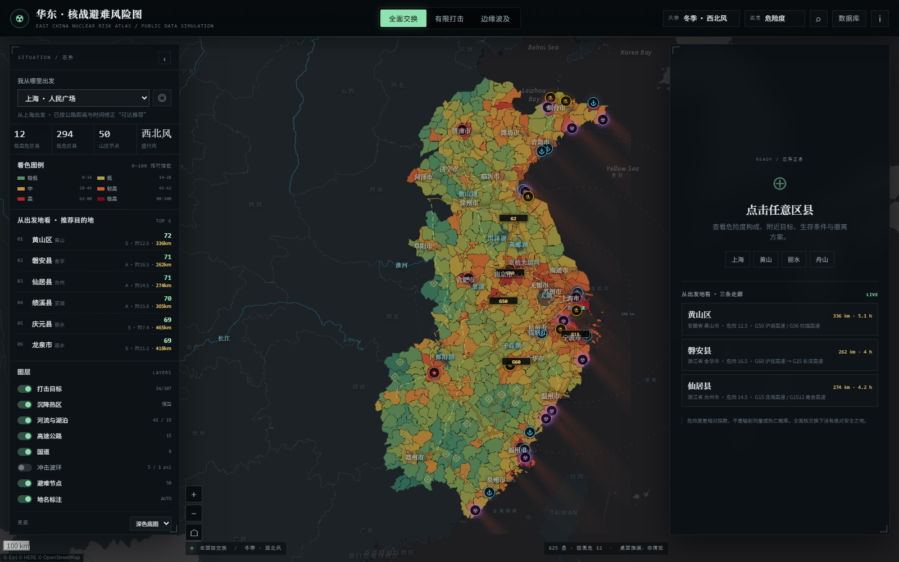
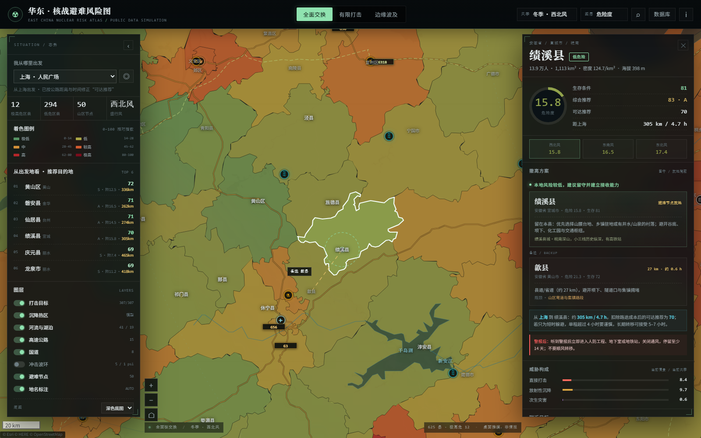
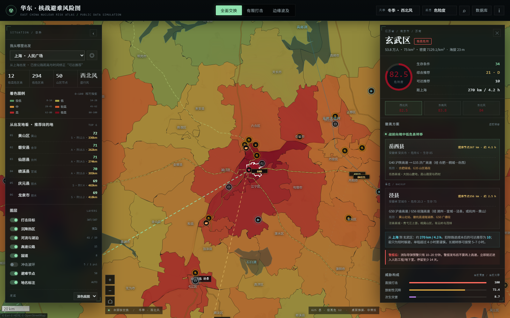

# 华东 · 核战避难风险图

> **EAST CHINA NUCLEAR RISK ATLAS** · 公开资料桌面推演 · 625 个县级单元



## 先读这一条

真实打击清单属最高机密。本项目只基于**公开地理、工业布局、人口、地形与风向**做桌面推演，**不代表任何真实打击计划、情报结论或官方判断**。

- 全面核交换下，长三角是全球目标最密集的区域之一，**不存在真正安全的地方**。
- 本图只在“有限打击、边缘波及、战后头几个月求生”这三种情境下有参考意义。
- 危险度是**相对指数**，不是辐射剂量、伤亡概率或“绝对安全”结论。
- 战时请以当地人防部门指令为准。**警报发布后不要上高速**，就近进入人防工程/地下室，停留至少 14 天。

## 它是什么

一个可离线打开的单页交互地图，覆盖上海、江苏、浙江、安徽、福建、江西、山东 **7 个省级行政区、77 个地级市、625 个县级单元**。

- 每个县有：危险度、打击/沉降/次生三分项、生存条件、综合推荐、可达推荐、附近目标、撤离主/备方案。
- 三种打击情景：**全面交换 / 有限打击 / 边缘波及**。
- 三种风季：**冬季西北风 / 夏季东南风 / 春秋东北风**，沉降热区实时重算。
- **主要河流与湖泊**：41 条河流/水道与 19 个湖泊，包括长江、黄河、淮河、赣江、闽江、瓯江、钱塘江、新安江、京杭大运河、太湖、洪泽湖、鄱阳湖、巢湖、千岛湖等。
- **高速公路与国道**：15 条高速走廊（G2/G15/G25/G40/G50/G60/G3/G56 等）+ 8 条国道走廊（G104/G105/G206/G312/G318/G320/G324/G327），沿实际公路路径生成，作示意。
- 12 个出发地：上海、南京、杭州、合肥、福州、南昌、济南、徐州、宁波、青岛、厦门、温州；也可用浏览器定位。
- “可达推荐”会按出发地扣除公路距离与时间成本，直接回答“我现在从这里走，现实中最值得去哪儿”。
- 数据库支持按区县/城市查看、排序、筛选、导出 CSV。





## 快速开始

> 想把这个项目推到自己的 GitHub / Gitee 仓库，见 [GIT_PUSH_GUIDE.md](GIT_PUSH_GUIDE.md)；想按阶段拆分提交，见 [GIT_COMMIT_PLAN.md](GIT_COMMIT_PLAN.md)。

### 方式一：直接打开（推荐）

双击 `index.html`，或运行：

```bat
启动地图.cmd
```

数据全部在本地文件中，`file://` 可直接工作。**底图瓦片需要联网**；断网时仍会显示县级色块、目标、避难节点与边界，只是没有地理底图。

### 方式二：本地 HTTP 服务

如果浏览器限制了本地脚本，可在项目目录运行：

```bash
node scripts/serve.mjs
# 打开 http://127.0.0.1:8765
```

## 文件结构

```
核战生存地图/
├─ index.html                 入口
├─ 启动地图.cmd               Windows 双击打开
├─ assets/
│  ├─ app.js                  交互逻辑、地图、详情、搜索、数据库
│  ├─ app.css                 界面样式
│  ├─ risk.js                 风险模型（Node 构建与浏览器共用）
│  └─ leaflet/                本地 Leaflet 1.9.4
├─ data/
│  ├─ database.js             前端主数据库（含几何、评分、方案）
│  ├─ context.js              邻省边界上下文
│  ├─ hydro.js                主要河流与湖泊
│  ├─ roads.js                高速与国道走廊
│  ├─ counties_scored.geojson 带评分的县级 GeoJSON（GIS 可用）
│  ├─ county_database.csv     县级总表（基线：全面打击/冬季）
│  ├─ city_summary.csv        地级市汇总（平均/最高危险度）
│  ├─ targets.csv             目标清单
│  ├─ summary.json            构建摘要 / TOP 列表
│  ├─ model/targets.json      人工校核的核心目标与权重
│  ├─ model/industry_additions.json  补充化工园区/化工企业与大型工厂
│  └─ raw/                    原始边界、人口、地形采样
├─ scripts/                   抓取、构建、服务脚本
└─ preview/                   截图
```

## 模型口径

### 1. 危险度（0–100）

对每个县级驻地，遍历目标清单，计算：

| 分项 | 权重 | 计算 |
|---|---:|---|
| 直接打击 / 冲击波 | 54% | 假设当量 150 kt；5 psi 半径 4.2 km、1 psi 半径 11 km，按当量立方根缩放，爆心外指数衰减 |
| 放射性沉降 | 32% | 按当前风季的下风向锥形羽流；横风宽度 `9 + 0.11x` km，沿下风 `exp(-x/140)`，近场附加各向同性沉积 |
| 次生灾害 | 14% | 石化毒云、核电污染、坝下洪水、港口/钢铁火灾 |

合成：`raw = 0.54×打击 + 0.32×沉降 + 0.14×次生`，再做 `100×(1-exp(-raw/45))` 饱和变换。

目标清单含 307 个公开节点：核电、军港/指挥、机场、港口、钢铁、石化、化工园区/化工企业（107）、大型工厂（28）、大坝、铁路编组、先进制造；其中 24 个为**外围背景目标**（郑州、武汉、北京、天津、广州等），用于修正省界边缘“人为低风险”。

### 2. 生存条件（0–100）

| 分项 | 权重 | 说明 |
|---|---:|---|
| 低危险度 | 34% | `100 − 危险度` |
| 地形遮蔽 | 26% | SRTM 90 m 每县 17 点采样：平均海拔 + 地形起伏 |
| 自持力 | 22% | 低人口密度、农业基础、水源/小水电潜力、地形 |
| 可达性 | 10% | 距上海公路时间估算 |
| 公共服务 | 8% | 县城/县级市/市辖区医疗与接待能力代理 |

### 3. 推荐度

```
综合推荐 = 0.58 × 安全 + 0.42 × 生存条件 − 平原惩罚
平原惩罚 = max(0, 40 − 地形遮蔽) × 0.18
可达推荐 = 综合推荐 − (0.032 × 距离km + 1.0 × max(0, 小时 − 1.5))
```

“平原惩罚”用于纠正“离目标远但无地形遮蔽”的误导。

### 4. 撤离方案

- **高危县**：在 350 km 内寻找低危、地形≥50、有基本设施的县作为主目的地；备选优先避难节点或地形≥55 的县。
- **低危县**：建议留守并建立接收能力；若为平原，会明确提示“就地准备＋预设山区转移”。
- **警报后**：所有方案都会切换为“就近人防/地下室，停留 14 天”，因为洲际导弹预警只有 10–20 分钟，开战后上高速等于堵死。

## 数据来源

- 阿里云 DataV.GeoAtlas 行政区划边界（2024）：625 个县级单元。
- 第七次全国人口普查分县资料（2020，[leiii/census](https://github.com/leiii/census)）：常住人口；部分新设/合并区按公开口径估算。
- OpenTopoData / SRTM 90 m：每县 17 点地形采样。
- 公开报道的核电、港口、钢铁、石化、化工园区、工厂、机场、水利、铁路编组设施位置（坐标约 1–5 km 误差）。
- Natural Earth 10m 河流/湖泊；OSRM / OpenStreetMap 公路路径（作走廊示意，非官方线位）。
- 公开气象常识：华东冬季西北风、夏季东南风、春秋东北风。
- 底图：Esri World Dark Gray Canvas / World Imagery（需联网）。

## 已知局限

- 不能预测真实打击顺序、当量、空爆/地爆、拦截率与政治决策。
- 目标清单是**分析假设**，不是“打击清单”；权重是分析判断，不是情报。
- 县级工业产值没有统一公开口径，模型用“目标清单 + 人口密度”作为目标价值代理，不是工业产值排名。
- 人口为 2020 年口径；部分新设区为估算，已在数据中标注 `popEstimated`。
- 距离/时间为直线距离乘道路系数的估算，不是导航；路线文字是走廊级建议。
- 沉降模型是高斯型简化，真实沉降受局地风、对流雨、地形和爆炸方式强烈影响。
- 战后真正的杀手往往是水源污染、疫病、饥荒与秩序崩溃，而不是爆心。

## 更新数据

```bash
# 1. 抓取华东县级边界
node scripts/fetch_geo.mjs

# 2. 合并 2020 人口（需 data/raw/census_county.csv）
node scripts/merge_pop.mjs

# 3. 采样地形（需要网络，约 2 分钟）
node scripts/fetch_elevation.mjs

# 4. 构建数据库
node scripts/build_db.mjs

# 5. 邻省上下文（可选）
node scripts/fetch_context.mjs

# 6. 河流/湖泊（Natural Earth + 人工校核）
node scripts/build_hydro.mjs

# 7. 高速/国道走廊（OSRM，需网络）
node scripts/fetch_roads.mjs
```

> 目标清单在 `data/model/targets.json` 中人工维护；修改后重跑 `build_db.mjs` 即可。

## 最后

如果只看“工业水平低、最不值得打”，答案是**浙西南丽水**；如果看“从上海出发能到、到了还能活”，答案是**皖南黄山—绩溪—泾县**；如果只看“绝对危险度最低”，会偏向**闽西—赣南—武夷山**。但那时你面对的已经不是一次打击，而是整个长三角的瘫痪。

**这张图不提供安全感，只提供一张更清醒的地图。**
